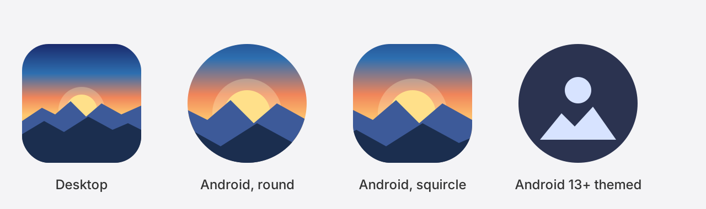

# App icon

The sun rising behind mountains at dawn. One design, shared by every platform.



| File | Use |
| --- | --- |
| [`icon.svg`](icon.svg) | Source of truth: full-colour icon on a rounded tile. Use it directly where SVG is accepted (Linux `hicolor/scalable/apps`). |
| [`icon-symbolic.svg`](icon-symbolic.svg) | Single-colour version for themed icons (Android 13+ monochrome, Linux `-symbolic` icons, tray/menu bar). |
| [`png/bing-wallpaper-<size>.png`](png/) | 16 to 1024 px exports for Linux `hicolor/<size>x<size>/apps`, Windows and macOS (`1024` is the App Store / `.icns` master). |
| [`bing-wallpaper.ico`](bing-wallpaper.ico) | Windows icon with 16 to 256 px inside. |

On Android the icon is drawn from vector drawables in `android/app/src/main/res/drawable/ic_launcher_*.xml`, which copy the shapes and colours from these SVGs (adaptive background and foreground, monochrome themed icon, and a round icon for Android 7). If you change the design, change both.

## Regenerating the exports

```sh
pip install cairosvg   # ImageMagick's `convert` is also needed for the .ico
python3 icon/export.py
```
